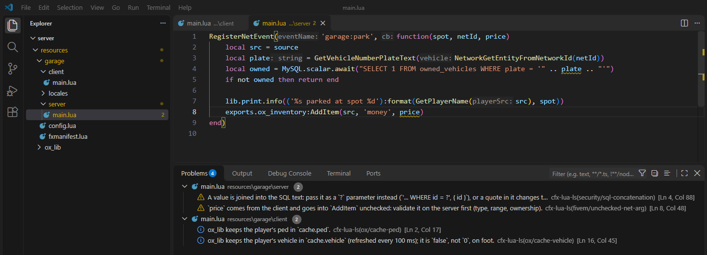
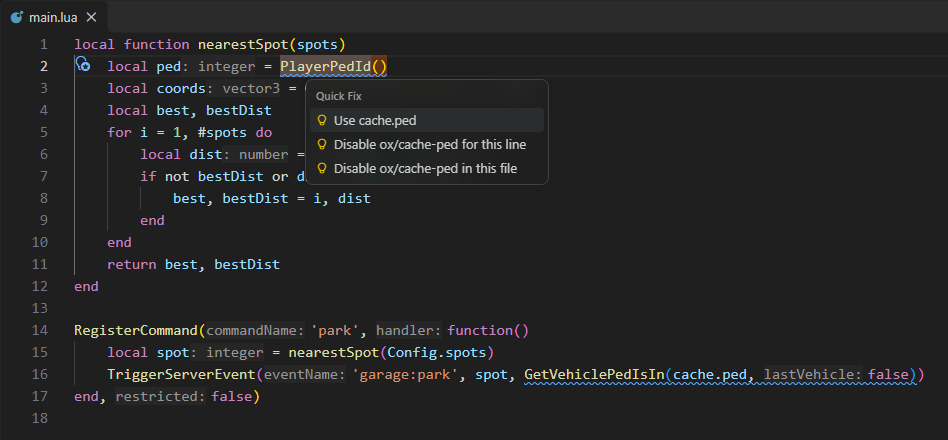
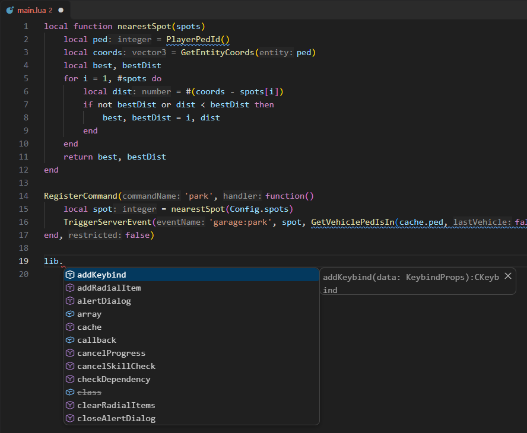

<p align="center">
  
</p>

<h1 align="center">cfx-lua-ls</h1>

<p align="center">
  <b>The Lua language server and linter built for FiveM.</b><br>
  A Rust port of lua-language-server in a fraction of its memory, plus what FiveM code needs.
</p>

<p align="center">
  <a href="https://marketplace.visualstudio.com/items?itemName=tgiann.cfx-lua-ls"></a>
  <a href="https://open-vsx.org/extension/tgiann/cfx-lua-ls"></a>
  <a href="https://github.com/TGIANN/cfx-lua-ls/actions/workflows/ci.yml"></a>
  <a href="LICENSE"></a>
</p>

<p align="center">
  <a href="#install">Install</a> ·
  <a href="#what-it-knows-about-fivem">Features</a> ·
  <a href="#check-a-whole-server">CLI</a> ·
  <a href="#in-github-actions">GitHub Actions</a> ·
  <a href="#for-ai-agents-mcp">MCP</a> ·
  <a href="docs/RULES.md">Rules</a>
</p>



## Why cfx-lua-ls

- **It reads your server the way FiveM does.** Every `fxmanifest.lua` decides
  which files run on the client, the server or both, what they import
  (`@ox_lib/init.lua`, `@oxmysql/...`, your framework) and which globals each
  file can see. Exports and events are followed across resources.
- **It is light.** Checking 623 files takes about 65 MB where
  lua-language-server takes a gigabyte, and runs about 20 times faster
  (see [the numbers](#speed-and-memory)).
- **It catches the bugs that cost a server.** Client values passed straight
  into money and item calls, values joined into SQL text, exports that do not
  exist, events fired with the wrong arguments, natives on the wrong side.
- **It speaks LuaLS.** Settings use LuaLS's keys (`.luarc.json`, `Lua.*`),
  the diagnostic codes and LuaCATS annotations are the same, and it passes
  LuaLS's own test cases ([details](#luals-compatibility)).
- **One engine, four places.** The editor, a CLI for whole servers, a GitHub
  Action with code scanning, and an MCP server for AI agents.

## Install

| where | how |
|---|---|
| VS Code | [Marketplace](https://marketplace.visualstudio.com/items?itemName=tgiann.cfx-lua-ls), or `ext install tgiann.cfx-lua-ls` in Quick Open |
| Cursor, VSCodium, Windsurf | [Open VSX](https://open-vsx.org/extension/tgiann/cfx-lua-ls): search for **CfxLua Language Server** |
| any LSP editor | download `cfx-lua-ls` from [Releases](https://github.com/TGIANN/cfx-lua-ls/releases) and run `cfx-lua-ls lsp` (stdio) |
| from source | `cargo build --release` |

The extension ships the server for Windows, Linux and macOS (Intel and Apple
silicon); there is nothing else to install. Turn off the Lua (LuaLS) extension
in the same workspace, or every problem shows twice.

## What it knows about FiveM

**ox_lib.** With `@ox_lib/init.lua` in the manifest, `lib.` lists ox_lib's
modules for the file's side, and calls ox_lib already caches are pointed out:
`PlayerPedId()` becomes `cache.ped` in one key, `GetVehiclePedIsIn(cache.ped, false)`
is `cache.vehicle`.



**Your workspace is the library.** Nothing from a framework is built in: the
server reads the copies of QBCore, Qbox, ESX and ox_lib in your workspace.
`exports.res:` lists `res`'s exports (also through `provide`, so
`exports['qb-core']:` on a Qbox server lists what qbx_core registers for it). A
value set from an export, such as `local QBCore = exports['qb-core']:GetCoreObject()`,
completes its fields (`QBCore.Functions.`) with the parameters, doc comments and
`---@deprecated` advice of their definitions, and go-to-definition opens them.



**Events.** Inside `TriggerServerEvent('` and the other event calls, completion
offers the workspace's event names, and go-to-definition jumps from a trigger to
its handlers. A trigger that sends more arguments than its handlers take, or
fewer than they require, is reported.

**Natives.** Hover, completion and signature help for the GTA V and RDR3
natives with their docs; a client-only native in a server file (or the
reverse) is an error.

**Types.** LuaCATS annotations (`---@class`, `---@type`, `---@param`, ...) are
read across the workspace: completion after any expression
(`ESX.GetPlayerFromId(src).`), types on hover, inlay hints (`Lua.hint.enable`,
off by default, on in the screenshots), and type checks
(`param-type-mismatch`, `missing-fields`, `need-check-nil`, `undefined-field`,
...) that stay quiet where they would only be guessing.

**121 rules.** Every LuaLS diagnostic, plus 58 of its own:

| group | examples |
|---|---|
| security | `fivem/unchecked-net-arg`, `security/sql-concatenation`, `qb/unchecked-player`, `fivem/net-event-same-side` |
| FiveM API | `fivem/unknown-export`, `fivem/wrong-side-native`, `fivem/event-argument-count`, `fivem/manifest-missing-file` |
| ox_lib | `ox/cache-ped`, `ox/cache-vehicle`, `ox/missing-locale`, ... |
| performance | `perf/concat-in-loop`, `perf/closure-in-loop`, `perf/table-insert-append`, ... |
| frameworks | `qb/core-object-event`, `esx/shared-object-event`, and the frameworks' own `---@deprecated` notes |

The full list, with what each rule flags and where it comes from, is in
[docs/RULES.md](docs/RULES.md).

## Speed and memory

`--check` on the same 623 Lua files (6.6 MB) of a production server's own
scripts, back to back on the same machine:

| | time | peak memory |
|---|---|---|
| lua-language-server 3.19.2 | 59 s (52-74) | 1,040 MB |
| **cfx-lua-ls 1.4.0** | **2.3 s (1.9-4.5)** | **65-69 MB** |

Windows, 16 threads; median wall time of warm runs with the range in brackets,
peak working set summed over the process and its children. Other programs were
running (2-3 of the 16 threads busy), which adds noise to both; on an idle
machine in November the same files took 33-36 s with LuaLS and 1.2 s with an
earlier cfx-lua-ls build.
Commands: `lua-language-server --check=<dir> --checklevel=Warning` and
`cfx-lua-ls check <dir> --all-files --level warning`.

## Check a whole server

```sh
cfx-lua-ls check path/to/resources
```

Every resource is read with its manifest; escrow-encrypted files are skipped.
`--format sarif` writes SARIF 2.1.0, `--fix` applies the quick fixes in place,
`--fail-on <level>` sets the exit code for CI. All options are in
[docs/CONFIGURATION.md](docs/CONFIGURATION.md#check-options).

### In GitHub Actions

The repository is also an action: it downloads a released `cfx-lua-ls`, checks
the paths given, sends the results to code scanning and fails the step at the
chosen level.

```yaml
permissions:
  contents: read
  security-events: write
steps:
  - uses: actions/checkout@v4
  - uses: TGIANN/cfx-lua-ls@v1
    with:
      path: resources      # folders or files, separated by spaces (default .)
      fail-on: error       # error, warning, information, hint or none
      sarif: true          # upload to code scanning
```

## For AI agents (MCP)

`cfx-lua-ls mcp` is a [Model Context Protocol](https://modelcontextprotocol.io)
server over stdio, so an agent can lint code before writing it and look up
natives, exports and events instead of guessing them. For Claude Code:

```sh
claude mcp add cfx-lua-ls -- /path/to/cfx-lua-ls mcp
```

| tool | |
|---|---|
| `check` | diagnostics for a file or folder, or for unsaved text; optional fixed text |
| `lint_snippet` | lint code before it is written to a file (side, ox_lib, known globals) |
| `native` | a native by name or a search: side, game, parameters, docs |
| `rules` | what each rule flags and why |
| `resource_info` | a file's resource, side, manifest imports and globals |
| `exports` | a resource's exports, from the server's own copy: parameters, side, deprecation, docs, file:line |
| `members` | what an expression holds at the end of a file (`QBCore.Functions`, `lib.callback`) |
| `events` | where an event is registered and triggered, or a search over event names |

## LuaLS compatibility

cfx-lua-ls is a from-scratch Rust port of
[lua-language-server](https://github.com/LuaLS/lua-language-server), checked
against LuaLS's own test cases:

| LuaLS test set | passing | not scored |
|---|---|---|
| type inference | 608 / 608 | 2 (Lua 5.5 syntax, a `??` operator CfxLua does not have) |
| diagnostics | 537 / 537 | 1 (Lua 5.5 `global`) |
| hover | 184 / 184, word for word | 9 (Chinese locale text, plain Lua 5.4's `utf8` / `_G`, `//` comments, Lua 5.5) |
| completion | 209 / 209 | |
| names (definition, references, rename) | 122 / 136 | 14, each with its reason in the test |

Every LuaLS diagnostic code is implemented, the ones LuaLS ships off stay off,
and `codestyle-check`, `name-style-check` and `spell-check` give LuaLS's
findings on real server code. The formatter follows EmmyLuaCodeStyle and reads
`.editorconfig`. Where a check would guess on FiveM code it is narrower than
LuaLS by default; `"cfx.lualsCompat": true` restores LuaLS's behaviour
([configuration](docs/CONFIGURATION.md#cfxlualscompat)).

## Configuration

`.luarc.json` and the editor's `Lua.*` settings, with LuaLS's keys:

```json
{
  "diagnostics.disable": ["fivem/citizen-prefix"],
  "diagnostics.globals": ["Config"]
}
```

Rule levels, groups, LuaLS's type switches, `Lua.workspace.library` and the
`check` options: [docs/CONFIGURATION.md](docs/CONFIGURATION.md).

## Build from source

```sh
cargo build --release            # the server: target/release/cfx-lua-ls
cd editors/vscode
npm ci
npm run typecheck
npm run build                    # the extension
```

Run VS Code with `--extensionDevelopmentPath=<repo>/editors/vscode` and set
`cfxLuaLs.server.path` to `<repo>/target/release/cfx-lua-ls(.exe)`. The plan,
the design decisions and what is still open are in
[docs/ROADMAP.md](docs/ROADMAP.md).

## License

MIT. Behaviour, tests and library definitions come from lua-language-server,
EmmyLuaCodeStyle and fivem-lls-addon, all MIT; see [NOTICE](NOTICE).
