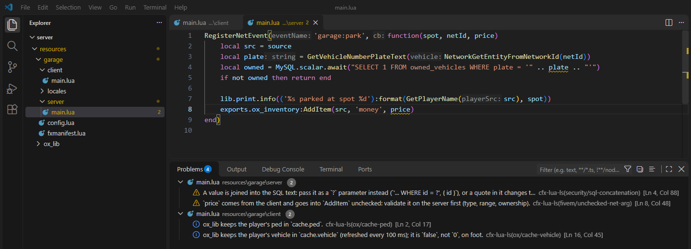
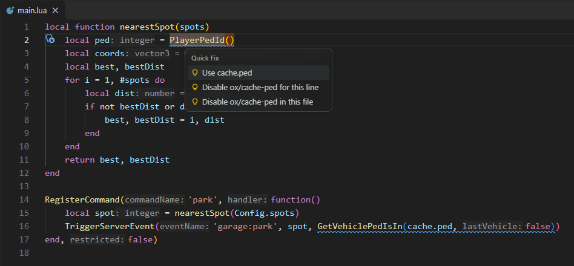
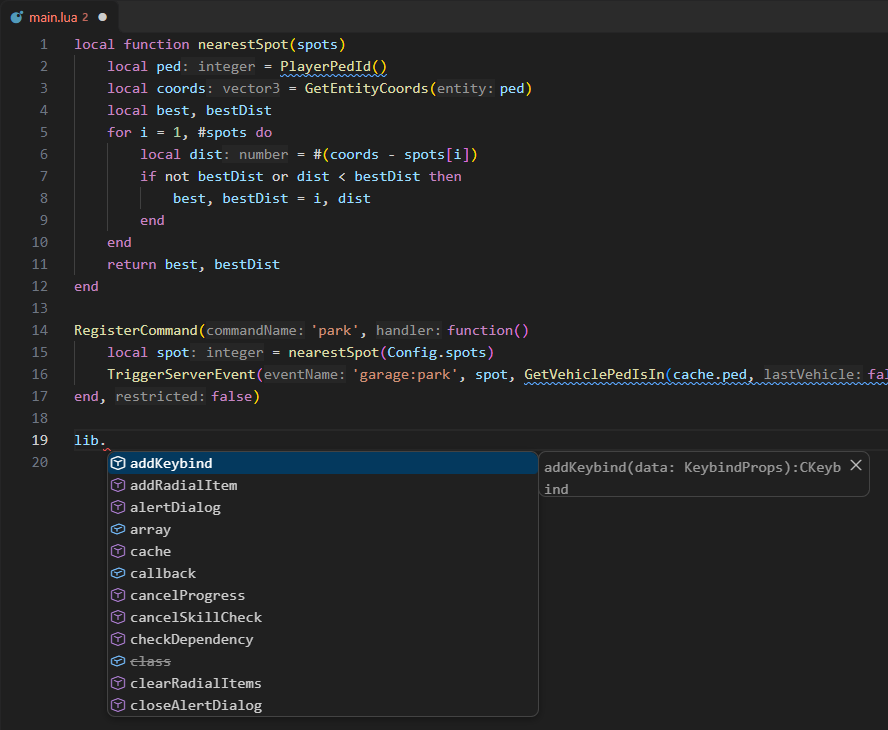

# CfxLua Language Server

**The Lua language server and linter built for FiveM.** A Rust port of
lua-language-server in a fraction of its memory, plus what FiveM code needs: `fxmanifest.lua` sides and imports, natives, exports, events, ox_lib,
QBCore, Qbox and ESX. Written in Rust.

## Features

- **Reads your server the way FiveM does.** Every `fxmanifest.lua` decides
  which files run on the client, the server or both, what they import and which
  globals each file can see.
- **Light.** Checking 623 files takes about 65 MB where lua-language-server
  takes a gigabyte, and runs about 20 times faster
  ([numbers](https://github.com/TGIANN/cfx-lua-ls#speed-and-memory)).
- **121 rules.** Every LuaLS diagnostic, plus 58 of its own: client values passed
  unchecked into money and item calls, values joined into SQL text, unknown
  exports, events fired with the wrong arguments, natives on the wrong side,
  ox_lib's `cache` values, performance traps
  ([full list](https://github.com/TGIANN/cfx-lua-ls/blob/main/docs/RULES.md)).
- **ox_lib aware.** `lib.` completes ox_lib's modules for the file's side;
  `PlayerPedId()` becomes `cache.ped` in one key.
- **Your frameworks, from your workspace.** Exports and framework objects
  (`exports['qb-core']:GetCoreObject()`, `ESX.GetPlayerFromId(src).`) complete
  with their parameters and docs; go-to-definition opens them. Event names
  complete inside `TriggerServerEvent('` and jump to their handlers.
- **Natives.** Hover, completion and signature help with the native docs.
- **Types.** LuaCATS annotations across the workspace: hover, inlay hints
  (`Lua.hint.enable`, off by default, on in the screenshots) and type checks.
- **Formatter.** EmmyLuaCodeStyle's style, from `.editorconfig`.

## Coming from the Lua (LuaLS) extension

Settings use LuaLS's keys (`.luarc.json`, `Lua.*`), and the diagnostic codes
and annotations are the same. Disable the Lua extension for the workspace,
or both servers run and every problem shows twice.

## Settings

| setting | default | |
|---|---|---|
| `cfxLuaLs.server.path` | empty | Absolute path to `cfx-lua-ls`, from user settings only (a workspace cannot choose the program that runs). Empty: the binary shipped in the extension, else `cfx-lua-ls` from an absolute `PATH` folder. |
| `cfxLuaLs.trace.server` | `off` | `messages` / `verbose` log the protocol to the output channel. |
| `Lua.*` | | LuaLS's settings: `Lua.diagnostics.*`, `Lua.workspace.library`, `Lua.hint.enable`, ... ([configuration](https://github.com/TGIANN/cfx-lua-ls/blob/main/docs/CONFIGURATION.md)) |

Command: **CfxLua: Restart Language Server**.

The same engine runs as a CLI for whole servers, a GitHub Action with code
scanning and an MCP server for AI agents: see the
[repository](https://github.com/TGIANN/cfx-lua-ls).
